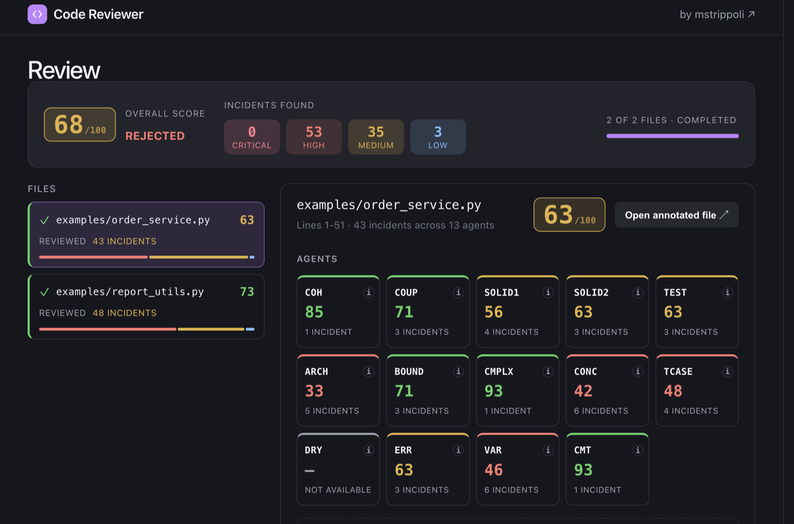

<div align="center">

# Code Reviewer

### An AI code reviewer that grades code on *sustainability*, not style rules

14 specialized AI agents review your Python code in parallel, each judging one design principle.
The result is one weighted, explainable score per file.

**[Live demo from my portfolio →](https://mstrippolidev.com/)**
<br>
<sub>The demo starts on demand, so it can take a few minutes to come up.</sub>

<br>


<br>
<sub>A review of two intentionally flawed example files: an overall score and recommendation, per-file results, and one rating per agent.</sub>

</div>

---

## Contents

1. [What is this?](#what-is-this)
2. [The 14 agents](#the-14-agents)
3. [How the score works](#how-the-score-works)
4. [Submission limits](#submission-limits)
5. [Installation](#installation)
6. [Running the tests](#running-the-tests)
7. [Tech stack](#tech-stack)

---

## What is this?

Most code checkers ask *"does this follow the rules?"* (line length, import order, naming style).
Tools like Black and Ruff already do that well.

This project asks a harder question: ***"Will this code be easy to change next year?"***

You give it a Python file or a GitHub repository. Fourteen AI reviewers each look at it through one
lens, such as *coupling*, *cohesion*, *testability* or *error handling*. They report specific
problems with line numbers, why each matters and how to fix it. A final step merges everything into
one weighted score and a recommendation: **approved**, **needs work** or **rejected**.

> Think of it as a panel of 14 senior engineers who each review the same file, then hand
> one combined report to the author.

You can log in with GitHub, register a repository, pick files and watch the review arrive agent by
agent. Without logging in, guest mode reviews up to five files from curated examples or your own upload.

For repositories you have registered, the reviewers can also compare a file against the rest of the
repository, for example to find duplicated code or the tests that cover a file.

## The 14 agents

Each agent judges one principle and returns a 0–100 rating plus a list of incidents. Agents use
judgment against a rubric rather than a fixed list of rules, so they can report a real problem that
no checklist anticipated.

| Weight | Agent | What it checks |
|---|---|---|
| **2.0** | SOLID1 | single responsibility, open/closed |
| **2.0** | SOLID2 | substitutability, interface segregation, dependency inversion |
| **2.0** | COH | cohesion: things that change together stay together |
| **2.0** | COUP | coupling: circular dependencies, feature envy, god objects |
| **2.0** | TEST | testability: hard-coded dependencies, hidden global state |
| **1.5** | TCASE | test gaps: what the existing tests do not cover |
| **1.5** | CONC | concurrency safety, with proposed fixes |
| **1.5** | CMPLX | cognitive complexity, nesting, clarity of flow |
| **1.5** | ARCH | layer violations and dependency direction |
| **1.5** | BOUND | encapsulation and information hiding |
| **1.0** | VAR | expressive names |
| **1.0** | DRY | duplicated code |
| **1.0** | ERR | error handling |
| **0.5** | CMT | comments and docstrings |

Weights reflect how much each principle affects whether code is easy to change. The five
sustainability pillars count four times as much as comments.

## How the score works

- **Per agent:** the rating starts at 100 and loses points for each incident:
  critical −20, high −15, medium −7, low −3 (never below 0).
- **Per file:** the weighted average of the agents' ratings.
- **Recommendation:**

| Result | When |
|---|---|
| `APPROVED` | weighted rating above 85, no agent rated 0, no critical incident |
| `NEEDS_WORK` | weighted rating from 60 to 85 |
| `REJECTED` | weighted rating below 60, any agent rated 0, or any critical incident |

Every incident carries a priority, the line range, a description and advice on how to fix it.

## Submission limits

| Limit | Value | What happens |
|---|---|---|
| Files per submission | 15 | The 15 largest source files are reviewed; the rest are listed as skipped. Test files are used as context, not reviewed. |
| File length, soft limit | 500 lines | The file is reviewed function by function, and a complexity incident is added. |
| File length, hard limit | 750 lines | The agents that need the whole file rate it 0, so the file is rejected. |

Submitted code is screened first: content that is not source code, or that tries to instruct the
reviewers (prompt injection), is rejected before any agent sees it.

## Installation

**Prerequisites**
- Python 3.10 or newer (the container images use 3.12)
- [uv](https://docs.astral.sh/uv/)
- Node.js
- PostgreSQL with the `pgvector` extension
- A Kafka broker
- One LLM backend: Ollama (local), OpenRouter, or AWS Bedrock

**Setup**

```bash
# 1. Configure
cp .env.example .env              # fill in database, Kafka, GitHub OAuth and model settings

# 2. Backend
uv sync
uv run alembic upgrade head
uv run uvicorn api.main:app --reload

# 3. Frontend
cd frontend && npm install && npm run dev
```

**Choosing a model backend**

Set `LLM_PROVIDER` and `EMBEDDING_PROVIDER` in `.env`, then fill in the variables for the provider you pick:

| Provider | `LLM_PROVIDER` | Variables to set |
|---|---|---|
| Ollama (local, free, private) | `ollama` | `OLLAMA_BASE_URL`, `OLLAMA_LLM_MODEL`, `OLLAMA_EMBED_MODEL`, `OLLAMA_CODE_EMBED_MODEL` |
| OpenRouter (hosted) | `openrouter` | `OPENROUTER_API_KEY`, `OPENROUTER_MODEL`, `OPENROUTER_FAST_MODEL`, `OPENROUTER_JUDGE_MODELS` |
| AWS Bedrock | `bedrock` | `BEDROCK_REGION`, `BEDROCK_LLM_MODEL`, plus AWS credentials in the environment |

OpenRouter has no embedding models, so with `LLM_PROVIDER=openrouter` keep `EMBEDDING_PROVIDER` on
`ollama` or `bedrock`. With Ollama, pull the models first (`ollama pull deepseek-r1:14b`,
`ollama pull nomic-embed-text`). Pick one `EMBEDDING_PROVIDER` and keep it: vectors from different embedding models can't be compared,
so switching it later means re-indexing every repo.

**Notes**
- Create the Kafka topics listed in `k8s/base/kafka/topics/` on your local broker.
- The `code_reviewer` schema must exist in your Postgres database.
- A GitHub OAuth App holds a single callback URL, so use a separate app for local development.
- Local models are free and private but slow on a laptop. For real reviews, point the app at
  OpenRouter or Bedrock through `.env`.

## Running the tests

```bash
uv run pytest                      # fast suite, no external services
uv run pytest -m llm               # real-model suites (run sparingly)
uv run pytest -m db                # needs a local Postgres
```

The default run uses fakes and finishes in seconds. The `llm`, `db`, `kafka`, `bedrock` and `sns`
suites are opt-in because they need real services.

## Tech stack

| Layer | Technology |
|---|---|
| Agents | LangChain |
| Retrieval | LlamaIndex, pgvector |
| LLM providers | Ollama, OpenRouter, AWS Bedrock |
| Backend | FastAPI, SQLAlchemy 2 (async), Alembic, Pydantic |
| Messaging | Apache Kafka |
| Frontend | React, Vite |
| Tooling | uv, pytest |

---

<div align="center">

Built by **Miquel Strippoli**.

</div>
